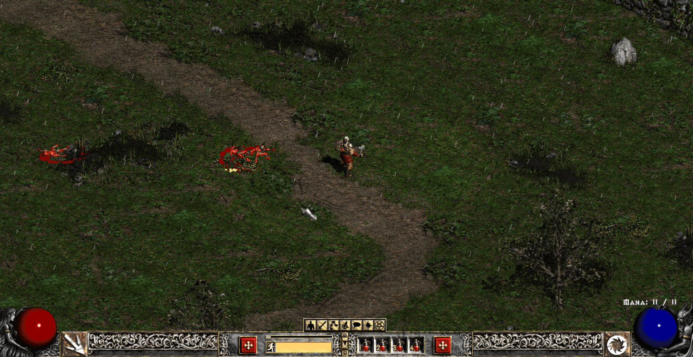
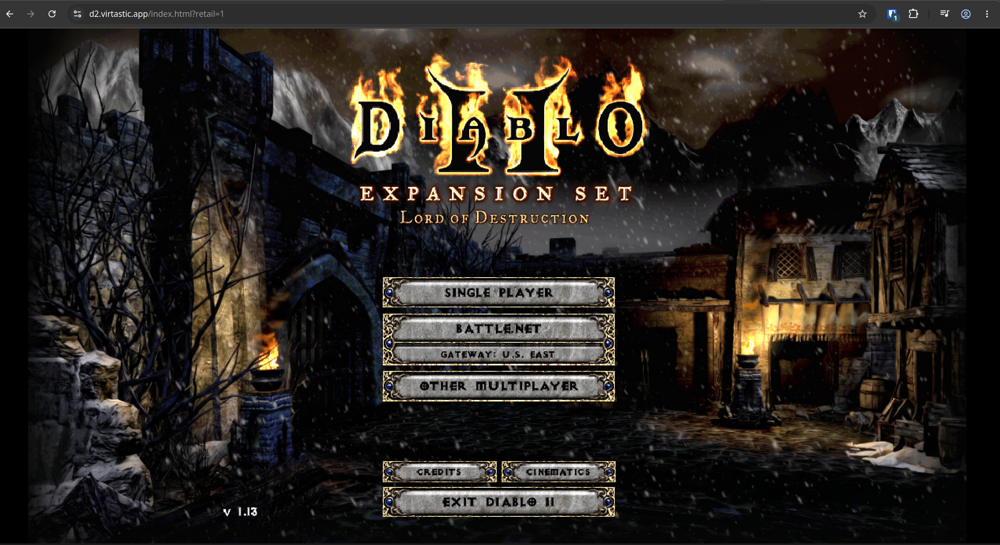
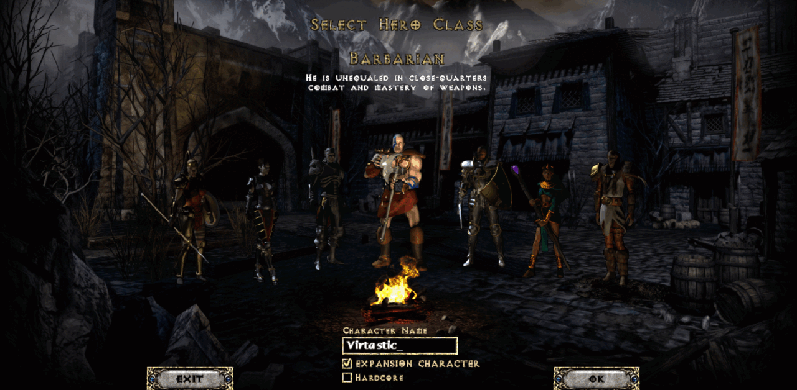

# d2-web

**Play Diablo II: Lord of Destruction in your browser.** The 1.13c engine, reimplemented and compiled to WebAssembly, by [Virtastic](https://virtastic.app).

<p align="center">
  <a href="https://diablo2.virtastic.app"></a>
</p>

<p>
  <a href="https://diablo2.virtastic.app"><b>▶ Play now at diablo2.virtastic.app</b></a> ·
  <a href="https://virtastic.app">Website</a> ·
  <a href="https://discord.gg/PzFfDkbSue">Discord</a> ·
  <a href="https://www.youtube.com/@Virtastic-Apps">YouTube</a> ·
  <a href="https://github.com/Virtastic/d2-web/issues">Issues</a>
</p>

[](https://discord.gg/PzFfDkbSue)
[](https://www.patreon.com/virtastic)
[](https://ko-fi.com/virtastic)
[](https://www.youtube.com/@Virtastic-Apps)
[](https://www.reddit.com/r/virtastic)


An unofficial reimplementation of the Diablo II: Lord of Destruction **1.13c** engine, compiled to
**WebAssembly** and played in the browser. No game data is included: you bring your own legally
owned copy.

> **Status: playable.** Create a character and play: towns, wilderness and dungeons, combat and
> skills, items, vendors, waypoints and saves, in a browser tab with nothing to install. Some
> details still differ from the original game. If you find one, please
> [report it](https://github.com/Virtastic/d2-web/issues).

## Screenshots

| | |
|---|---|
|  |  |

*Screenshots are rendered from the player's own game files; the art is Blizzard's.*

## You need your own copy of the game

d2-web ships **no Blizzard assets**: no MPQs, art, sound, text or binaries. It reads them from your
own legally owned install of Diablo II + Lord of Destruction, patched to **1.13c**. You need the
`.mpq` files from the install folder (`d2data.mpq`, `d2exp.mpq`, `d2char.mpq`, `d2sfx.mpq`,
`d2music.mpq`, `d2speech.mpq`, `d2video.mpq`, `d2xmusic.mpq`, `d2xtalk.mpq`, `d2xvideo.mpq` and
`patch_d2.mpq`). Without them no game starts.

## Quick start with Docker

The release image `ghcr.io/virtastic/d2-web` holds the engine and the client, and **no game data**. Your own copy of Diablo II: Lord of Destruction supplies the files: the disc MPQs (`d2data.mpq`, `d2exp.mpq`, `d2char.mpq`, `d2sfx.mpq`, `d2music.mpq`, `d2xmusic.mpq`, `d2speech.mpq`, `d2xtalk.mpq`, `d2video.mpq`, `d2xvideo.mpq`) and the 1.13c `patch_d2.mpq`. `D2_ASSETS` decides where those files come from.

**Bring your own files (default, `D2_ASSETS=byo`).** The server holds no game data. Each player opens the page and chooses their own D2 folder or MPQs, and the files stay in their browser.

```bash
docker run -d --name d2-web --restart unless-stopped -p 8080:8080 ghcr.io/virtastic/d2-web:latest
```

**Hosted files (`D2_ASSETS=hosted`).** The server serves the MPQs from a folder you mount at `/retail`, and players just open the page. Use this only for players who own the game, for example behind a login such as Cloudflare Access.

```bash
docker run -d --name d2-web --restart unless-stopped -p 8080:8080 \
  -e D2_ASSETS=hosted -v /path/to/Diablo2:/retail:ro ghcr.io/virtastic/d2-web:latest
```

With Compose:

```yaml
services:
  d2-web:
    image: ghcr.io/virtastic/d2-web:latest
    restart: unless-stopped
    ports: ["8080:8080"]
    environment:
      D2_ASSETS: hosted                         # or byo, and drop the volume
    volumes: ["/path/to/Diablo2:/retail:ro"]
```

Then open `http://localhost:8080/`. Anywhere other than localhost, put HTTPS in front of the container (Caddy, nginx, Cloudflare Tunnel), because the engine needs `SharedArrayBuffer`, which browsers grant only on HTTPS or localhost.

### Building your own image

```sh
bash ci/build.sh                          # with your game files in retail/D2/ -- see "Front-door art" below
tools/docker-release.sh v0.1.1 --no-push  # build the image locally only
tools/docker-release.sh v0.1.1            # build, then push <tag> and latest
```

`tools/docker-release.sh` builds the image from the staged site in `build-wasm/site/`. Before
building, it checks that the site is complete:

| staged path | if it is missing |
|---|---|
| `e/<version>/d2.wasm`, `serve.mjs` | stops: run `ci/build.sh` first |
| `assets/patch-113c.patch` | stops: stage with your 1.13c `patch_d2.mpq` (see below) |
| `door-art/meta.json` | stops: stage with `patch_d2.mpq`, `d2exp.mpq` and `d2data.mpq` (see below) |
| `freeres/` (16 `.dc6` files and `LICENSE.md`) | stops: run `ci/stage.sh`; these files are in git |
| `widebg/manifest.json` | warns and builds without it: the menus use the game's own 4:3 backgrounds |

The image always leaves out `vectors/`, `diag/` and any link to your game folder.

**The image contains files made from your game data.** The front-door art and the patch file are
cut from your game files when you build, and both are copied into the image. Treat the image like
your game files: keep it on your own registry or machine unless you are sure you may share it.

## 1. Build

Requirements: Linux, macOS or Windows with WSL2; Docker; Node.js 24+; git.

```sh
git clone https://github.com/Virtastic/d2-web.git
cd d2-web
git clone https://github.com/ladislav-zezula/StormLib third_party/StormLib
bash ci/build.sh
```

`ci/build.sh` builds an emscripten toolchain image, compiles the engine to wasm and writes the
finished site to `build-wasm/site/`. The first run takes a while; later runs are cached.

### Front-door art and the patch file (built from your own game files)

The front door is the page a player sees before choosing their game files: the title art, the
file picker and the loading screen. It reads four files and folders from the staged site. One is
in git. Two are cut from **your own** game files every time you build. One is optional and made
by hand. Nothing made from game data is ever committed, which is why a fresh clone does not have
it.

**Your 1.13c `patch_d2.mpq` is required.** Without it, `ci/stage.sh` (and so `ci/build.sh`) stops
with `FATAL: no retail/D2/patch_d2.mpq`. It has to be the exact `Patch_D2.mpq` that the 1.13c
update installs. `tools/patch-shim.mjs` compares the file's size and SHA-256 with that file and
refuses anything else, including other patch versions and modified copies:

| | |
|---|---|
| size | 8,229,959 bytes |
| SHA-256 | `41a5fc95977369e3d5f32127cc4c0d571daad9cf706b6b6523935b705afc5a6d` |

`tools/docker-release.sh` runs the same check (`node tools/patch-shim.mjs --check`) on the staged
`assets/patch-113c.patch` before it builds an image.

| staged path | what it is | made from | made by | without it |
|---|---|---|---|---|
| `freeres/` | the widescreen bottom bar and border panels: 16 `.dc6` files plus their licence | `play/freeres/` in git (SGD2FreeRes art, under its own licence) | `ci/stage.sh` copies it | the build stops |
| `door-art/` | the title-screen art the door draws before any files are chosen (details below) | your `patch_d2.mpq`, `d2exp.mpq`, `d2data.mpq` | `tools/door-art.mjs` | warning; the door draws in a plain web font until the player's files load, then cuts the same art in the browser from the player's files |
| `assets/patch-113c.patch` | your 1.13c `patch_d2.mpq` as base64 text | your 1.13c `patch_d2.mpq` | `tools/patch-shim.mjs` | **the build stops**: this file is required |
| `widebg/` | optional widescreen menu backgrounds | images you supply | `ci/stage.sh` copies them | the menus use the game's own 4:3 backgrounds |

**What `door-art/` contains:**

- the burning logo, in four PNGs: `logo_blackL`, `logo_fireL`, `logo_blackR`, `logo_fireR`;
- the wide button (`wide`), the hand cursor (`cursor`) and the loading screen (`loading`);
- font sheets cut from the game's bitmap fonts:
  - `f_font16_<colour>` in white, red, gold, grey and tan;
  - `f_font30_gold`;
  - `f_fontexocet10_white`;
- `meta.json`, which gives the width of every character in each font.

**The text is not baked into the images.** Each font sheet is a grid with one cell per character.
The words are ordinary strings in `play/assets/byo-door.mjs`, and the door copies one character at
a time from the sheet onto the canvas, the way the game draws text. To change the wording, edit the
code; you never need to edit the art.

The art comes from `data\global\ui\FrontEnd\`, `data\local\font\latin\` and the palettes in
`data\global\palette\`. When a file is in more than one archive, the first one wins, in the order
`patch_d2.mpq`, `d2exp.mpq`, `d2data.mpq`.

**Why the patch file exists.** Players can bring a game at any patch level, but the engine only
reads 1.13c data. The page therefore mounts `patch-113c.patch` as `Patch_D2.mpq` on top of
whatever patch the player chose. The base archives are the same at every patch level, so the
player only has to supply those.

#### Building them

Put three archives from a Diablo II: Lord of Destruction install **patched to 1.13c** in
`retail/D2/`. `*.mpq` files are gitignored, so they can never be committed. Then build:

```sh
mkdir -p retail/D2
cp "/path/to/Diablo II/Patch_D2.mpq" retail/D2/patch_d2.mpq
cp "/path/to/Diablo II/d2exp.mpq"    retail/D2/d2exp.mpq
cp "/path/to/Diablo II/d2data.mpq"   retail/D2/d2data.mpq
bash ci/build.sh            # or ci/stage.sh, to restage without rebuilding the wasm
```

The build log should print both of these lines:

```
patch shim: retail/D2/patch_d2.mpq (8229959 bytes, 1.13c) -> build-wasm/site/assets/patch-113c.patch
door-art: ... images -> build-wasm/site/door-art
```

If the build stops with `FATAL: no retail/D2/patch_d2.mpq`, or warns `WARNING: no
retail/D2/d2data.mpq`, check the names: the build looks them up in **lower case**
(`patch_d2.mpq`, `d2data.mpq`).

To use your install folder without copying, set `D2_PATCH_SHIM_SRC=/path/to/Diablo\ II/patch_d2.mpq`.
The build looks for `d2exp.mpq` and `d2data.mpq` in the same folder as that patch.

You can also run both tools on their own:

```sh
node tools/patch-shim.mjs "/path/to/Diablo II/Patch_D2.mpq" build-wasm/site/assets/patch-113c.patch
node tools/door-art.mjs   "/path/to/Diablo II"              build-wasm/site/door-art
```

`tools/door-art.mjs` accepts any letter case in the archive names.

#### Widescreen menu backgrounds (optional)

d2-web opens in a widescreen view by default. Each menu screen (title, game select, character
select, character creation, credits) normally draws the game's own 800×600 background, centred
with black bars on either side. To fill the whole screen instead, supply larger painted
backgrounds:

1. Put a JPG or PNG for each screen in `.widebg/` at the root of the main checkout, or in any
   folder named by `D2_WIDEBG_DIR`. `.widebg/` is gitignored.
2. Add a `manifest.json` in the same folder. Each screen is keyed by the lower-case name of the
   game background it replaces:
   - `trademarkscreenexp` (title screen);
   - `gameselectscreenexp` (game select);
   - `characterselectscreenexp` (character select);
   - `charactercreationscreenexp` (character creation);
   - `creditsbckgexpand` (credits).

   ```json
   {
     "trademarkscreenexp": { "file": "title.jpg", "w": 2752, "h": 1536, "s": 1.94, "ox": 585.31, "oy": 283.5 },
     "gameselectscreenexp": { "file": "gameselect.jpg", "w": 2752, "h": 1536, "s": 2.5171, "sy": 2.5685, "ox": 373.69, "oy": -3.38 }
   }
   ```

   | field | meaning |
   |---|---|
   | `file` | the image file, in the same folder as `manifest.json` |
   | `w`, `h` | the image's width and height in pixels |
   | `ox`, `oy` | where the game screen's top-left pixel (0,0) sits in the image |
   | `s` | how many image pixels one game pixel covers, horizontally |
   | `sy` | the same, vertically; defaults to `s` (set it only for an image stretched slightly differently in each direction) |

   These values line your image up with the game's 800×600 screen. Buttons, text and other
   overlays are still drawn at the game's own positions, so the painting has to match the
   original background where the overlays sit.
3. Run `ci/stage.sh` (or `ci/build.sh`). It copies the folder to `build-wasm/site/widebg/`,
   following links.

A screen with no entry, or a missing `widebg/` folder, uses the game's own background. The repo
ships no backgrounds. Use only images you have the right to use.

## 2. Run it locally

```sh
D2_RETAIL_DIR="/path/to/Diablo II" node play/serve.mjs 8920 build-wasm/site
```

Open <http://localhost:8920/>.

`play/serve.mjs` is a small Node server with no dependencies. It serves the site, serves your MPQs
under `/retail/`, and sets the cross-origin isolation headers (COOP/COEP) the wasm threads need.
**A plain static file server will not work** without those headers.

## 3. Host it on your own machine or LAN

The same server can listen on your network:

| variable | effect |
|---|---|
| `D2_BIND=0.0.0.0` | listen on every interface (default `127.0.0.1` only) |
| `D2_TLS_DIR=<dir>` | serve HTTPS using `<dir>/key.pem` and `<dir>/cert.pem` |
| `D2_RETAIL_DIR=<dir>` | the folder holding your `.mpq` files |
| `PORT` | port, if not given as the first argument |

```sh
D2_BIND=0.0.0.0 D2_TLS_DIR=~/certs D2_RETAIL_DIR="/path/to/Diablo II" \
  node play/serve.mjs 8443 build-wasm/site
```

Browsers only allow the threaded build on `localhost` or over **HTTPS**, so any other device needs
TLS (a self-signed certificate or one from your own CA is fine on a home network).

The server has **no authentication**. Keep it on a private network: whoever can reach it can
download the MPQs you point it at, and redistributing Blizzard's files is not allowed. Do not expose
it to the internet.

Saves live in the browser's own storage on each device.

Battle.net is off. d2-web does not run or connect to any official service.

## Troubleshooting

- **Blank page or "SharedArrayBuffer is not defined"**: the page isn't cross-origin isolated. Use
  `play/serve.mjs`, and use `localhost` or HTTPS.
- **"missing .mpq" or the title screen never appears**: check that `D2_RETAIL_DIR` points at the
  folder holding the files listed above, and that `patch_d2.mpq` is the 1.13c one.
- **Build fails pulling the image**: check that Docker is running and that your user can use it.

## Tests

```sh
node --test test/*.test.mjs
```

## Layout

| path | what |
|---|---|
| `src/core/` | the engine, by retail DLL (common, game, client, gfx, net, ...) |
| `src/core/d2moo/` | code adapted from D2MOO (MIT) |
| `play/` | the browser client and the dev server |
| `tools/` | build helpers and the realm protocol tools |
| `ci/` | build scripts |

## Contributing

See [CONTRIBUTING.md](CONTRIBUTING.md). Security issues: [SECURITY.md](SECURITY.md).

## Credits

- **D2MOO** (ThePhrozenKeep): part of `src/core/d2moo` is adapted from it.
- **StormLib** (Ladislav Zezula): MPQ archive reading.
- **libd2**, **d2mapapi**, **PlugY**, **d2bs**, **D2Ex2** and the **Phrozen Keep** guides: prior
  art and cross-checks.
- **OpenDiablo2** and **OpenD2**: cross-checks for front-end screen layouts, key bindings and
  file formats (DC6/DCC/COF/PL2/TBL). Neither project's code is used. d2-web is not a fork of
  either one and not based on them. Its engine is reimplemented from the retail 1.13c program.
- **unbikit**: Bink video decoding.

See [NOTICE](NOTICE) for licences. Much of the code was written with heavy help from AI coding
tools, directed and reviewed by a human maintainer.

## Legal

d2-web is a fan project. It is not affiliated with, endorsed by, or sponsored by Blizzard
Entertainment. Diablo and Blizzard Entertainment are trademarks or registered trademarks of
Blizzard Entertainment, Inc. in the U.S. and/or other countries. All game content belongs to its
owners; you must own the game to use this project. The engine was written by studying the retail
1.13c program (it was not written clean-room), and it ships no Blizzard files or data.

The d2-web source code is released under the [MIT License](LICENSE).
