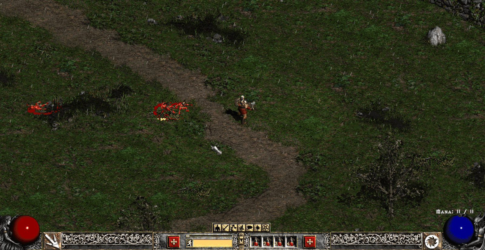
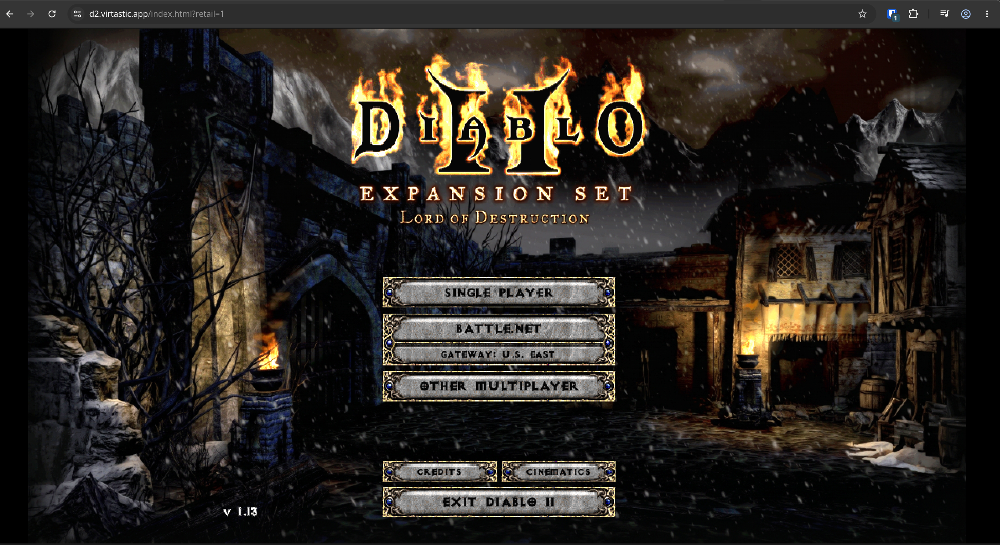
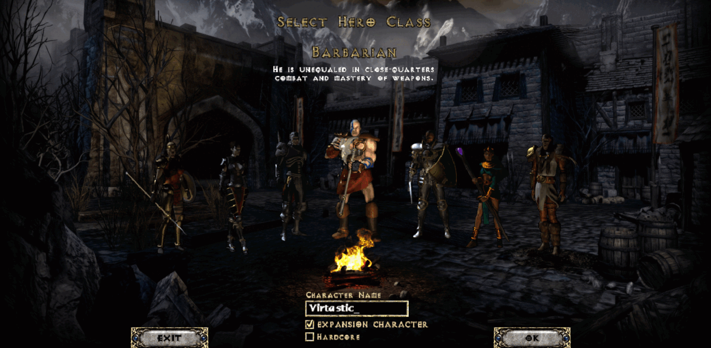

# d2-web

**Play Diablo II: Lord of Destruction in your browser.** The 1.13c engine, reimplemented and compiled to WebAssembly, by [Virtastic](https://virtastic.app).

<p align="center">
  <a href="https://diablo2.virtastic.app"></a>
</p>

<p>
  <a href="https://diablo2.virtastic.app"><b>▶ Play now at diablo2.virtastic.app</b></a> ·
  <a href="https://virtastic.app">Website</a> ·
  <a href="https://discord.gg/PzFfDkbSue">Discord</a> ·
  <a href="https://www.youtube.com/@Virtastic-Apps">YouTube</a> ·
  <a href="https://github.com/Virtastic/d2-web/issues">Issues</a>
</p>

[](https://discord.gg/PzFfDkbSue)
[](https://www.patreon.com/virtastic)
[](https://ko-fi.com/virtastic)
[](https://www.youtube.com/@Virtastic-Apps)
[](https://www.reddit.com/r/virtastic)


An unofficial reimplementation of the Diablo II: Lord of Destruction **1.13c** engine, compiled to
**WebAssembly** and played in the browser. No game data is included: you bring your own legally
owned copy.

> **Status: early alpha.** Act 1 runs: character creation, Rogue Encampment, the first wilderness
> areas, combat, items, vendors, waypoints and saves. It is not a complete game yet, and you will
> hit bugs, missing screens and wrong behaviour. Please report them.

## Screenshots

| | |
|---|---|
|  |  |

*Screenshots are rendered from the player's own game files; the art is Blizzard's.*

## You need your own copy of the game

d2-web ships **no Blizzard assets**: no MPQs, art, sound, text or binaries. It reads them from your
own legally owned install of Diablo II + Lord of Destruction, patched to **1.13c**. You need the
`.mpq` files from the install folder (`d2data.mpq`, `d2exp.mpq`, `d2char.mpq`, `d2sfx.mpq`,
`d2music.mpq`, `d2speech.mpq`, `d2video.mpq`, `d2xmusic.mpq`, `d2xtalk.mpq`, `d2xvideo.mpq` and
`patch_d2.mpq`). Without them no game starts.

## Quick start with Docker

The release image `ghcr.io/virtastic/d2-web` holds the engine and the client, and **no game data**. Your own copy of Diablo II: Lord of Destruction supplies the files: the disc MPQs (`d2data.mpq`, `d2exp.mpq`, `d2char.mpq`, `d2sfx.mpq`, `d2music.mpq`, `d2xmusic.mpq`, `d2speech.mpq`, `d2xtalk.mpq`, `d2video.mpq`, `d2xvideo.mpq`) and the 1.13c `patch_d2.mpq`. `D2_ASSETS` decides where those files come from.

**Bring your own files (default, `D2_ASSETS=byo`).** The server holds no game data. Each player opens the page and chooses their own D2 folder or MPQs, and the files stay in their browser.

```bash
docker run -d --name d2-web --restart unless-stopped -p 8080:8080 ghcr.io/virtastic/d2-web:latest
```

**Hosted files (`D2_ASSETS=hosted`).** The server serves the MPQs from a folder you mount at `/retail`, and players just open the page. Use this only for players who own the game, for example behind a login such as Cloudflare Access.

```bash
docker run -d --name d2-web --restart unless-stopped -p 8080:8080 \
  -e D2_ASSETS=hosted -v /path/to/Diablo2:/retail:ro ghcr.io/virtastic/d2-web:latest
```

With Compose:

```yaml
services:
  d2-web:
    image: ghcr.io/virtastic/d2-web:latest
    restart: unless-stopped
    ports: ["8080:8080"]
    environment:
      D2_ASSETS: hosted                         # or byo, and drop the volume
    volumes: ["/path/to/Diablo2:/retail:ro"]
```

Then open `http://localhost:8080/`. Anywhere other than localhost, put HTTPS in front of the container (Caddy, nginx, Cloudflare Tunnel), because the engine needs `SharedArrayBuffer`, which browsers grant only on HTTPS or localhost.

Cut a release with `bash ci/build.sh && tools/docker-release.sh v0.1.1`. The script builds the image from `build-wasm/site`, leaves out `vectors/` and `widebg/` (retail-derived), and pushes `<tag>` and `latest`.

## 1. Build

Requirements: Linux, macOS or Windows with WSL2; Docker; Node.js 24+; git.

```sh
git clone https://github.com/Virtastic/d2-web.git
cd d2-web
git clone https://github.com/ladislav-zezula/StormLib third_party/StormLib
bash ci/build.sh
```

`ci/build.sh` builds an emscripten toolchain image, compiles the engine to wasm and writes the
finished site to `build-wasm/site/`. The first run takes a while; later runs are cached.

## 2. Run it locally

```sh
D2_RETAIL_DIR="/path/to/Diablo II" node play/serve.mjs 8920 build-wasm/site
```

Open <http://localhost:8920/?retail=1>.

`play/serve.mjs` is a small Node server with no dependencies. It serves the site, serves your MPQs
under `/retail/`, and sets the cross-origin isolation headers (COOP/COEP) the wasm threads need.
**A plain static file server will not work** without those headers.

## 3. Host it on your own machine or LAN

The same server can listen on your network:

| variable | effect |
|---|---|
| `D2_BIND=0.0.0.0` | listen on every interface (default `127.0.0.1` only) |
| `D2_TLS_DIR=<dir>` | serve HTTPS using `<dir>/key.pem` and `<dir>/cert.pem` |
| `D2_RETAIL_DIR=<dir>` | the folder holding your `.mpq` files |
| `D2_RETAIL_REDIRECT=1` | a bare page load goes straight to `?retail=1` |
| `PORT` | port, if not given as the first argument |

```sh
D2_BIND=0.0.0.0 D2_TLS_DIR=~/certs D2_RETAIL_DIR="/path/to/Diablo II" D2_RETAIL_REDIRECT=1 \
  node play/serve.mjs 8443 build-wasm/site
```

Browsers only allow the threaded build on `localhost` or over **HTTPS**, so any other device needs
TLS (a self-signed certificate or one from your own CA is fine on a home network).

The server has **no authentication**. Keep it on a private network: whoever can reach it can
download the MPQs you point it at, and redistributing Blizzard's files is not allowed. Do not expose
it to the internet.

Saves live in the browser's own storage on each device.

## Options

| URL flag | effect |
|---|---|
| `?retail=1` | load your MPQs from the server |
| `?enhanced=1` | quality-of-life options (wider view and similar) |
| `?plugy=1` | PlugY-style extended stash |
| `&debug=1` | debug overlay |

Battle.net is off. d2-web does not run or connect to any official service.

## Troubleshooting

- **Blank page or "SharedArrayBuffer is not defined"**: the page isn't cross-origin isolated. Use
  `play/serve.mjs`, and use `localhost` or HTTPS.
- **"missing .mpq" or the title screen never appears**: check that `D2_RETAIL_DIR` points at the
  folder holding the files listed above, and that `patch_d2.mpq` is the 1.13c one.
- **Build fails pulling the image**: check that Docker is running and that your user can use it.

## Tests

```sh
node --test test/*.test.mjs
```

## Layout

| path | what |
|---|---|
| `src/core/` | the engine, by retail DLL (common, game, client, gfx, net, ...) |
| `src/core/d2moo/` | code adapted from D2MOO (MIT) |
| `play/` | the browser client and the dev server |
| `tools/` | build helpers and the realm protocol tools |
| `ci/` | build scripts |

## Contributing

See [CONTRIBUTING.md](CONTRIBUTING.md). Security issues: [SECURITY.md](SECURITY.md).

## Credits

- **D2MOO** (ThePhrozenKeep): part of `src/core/d2moo` is adapted from it.
- **StormLib** (Ladislav Zezula): MPQ archive reading.
- **libd2**, **d2mapapi**, **PlugY**, **d2bs**, **D2Ex2** and the **Phrozen Keep** guides: prior
  art and cross-checks.
- **unbikit**: Bink video decoding.

See [NOTICE](NOTICE) for licences. Much of the code was written with heavy help from AI coding
tools, directed and reviewed by a human maintainer.

## Legal

d2-web is a fan project. It is not affiliated with, endorsed by, or sponsored by Blizzard
Entertainment. Diablo and Blizzard Entertainment are trademarks or registered trademarks of
Blizzard Entertainment, Inc. in the U.S. and/or other countries. All game content belongs to its
owners; you must own the game to use this project. The engine was written by studying the retail
1.13c program (it was not written clean-room), and it ships no Blizzard files or data.

The d2-web source code is released under the [MIT License](LICENSE).
